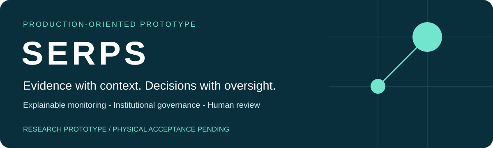
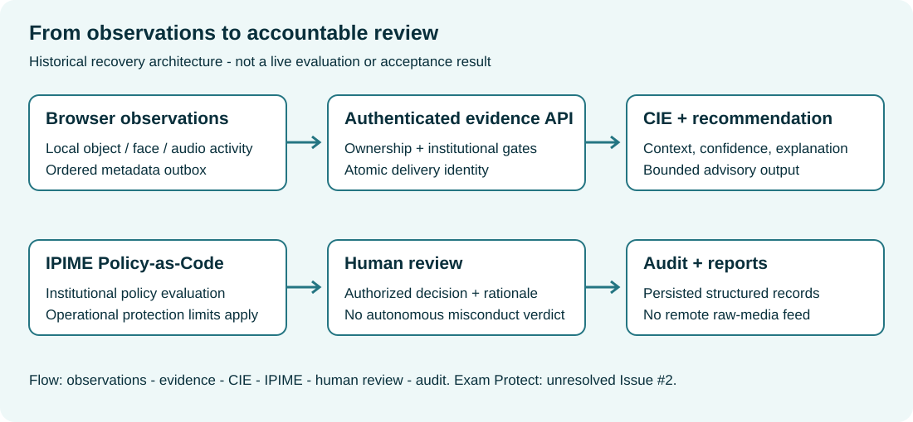

<strong>Research prototype RC1</strong> - <strong>Source-linked engineering evidence</strong> - <strong>No public deployment</strong>

# SERPS POP

Educational assessment needs trustworthy evidence without turning uncertain sensor observations into automatic misconduct judgments. **SERPS explores how local multimodal monitoring, explainable reasoning and institutional policy can support accountable human review.**

The prototype engineers a Next.js/TypeScript interface, a FastAPI evidence API, local vision and audio-activity processing, bounded contextual rules, role-based access and reviewer/audit workflows. Its research approach separates observation, interpretation, policy and human authority, making those boundaries available for evaluation rather than treating detection as a verdict.

**Evidence:** source-linked implementation and revision-specific software regression reports. These establish engineering progress, not independently validated accuracy, fairness, biometric assurance or educational outcomes. The next research opportunities are uncertainty-aware monitoring, explanation usefulness, privacy/utility trade-offs and assessment validity; handwriting-centered assessment is a proposed extension.

**Scope:** a Production-Oriented Prototype with a bounded demonstration workspace, not a complete CBT platform, secure browser, certified biometric system or autonomous adjudicator. Physical-camera and candidate identity acceptance, independent security review and further engineering validation remain incomplete.

[Evidence matrix](docs/portfolio/evidence-matrix.md) - [Evidence boundaries](#evidence-and-acceptance) - [Architecture](#architecture-and-operating-modes) - [Reproducibility](#deployment-and-verification) - [Limitations](#acceptance-boundaries)

## Research and engineering portfolio

| Read for | Start here | What it establishes |
| --- | --- | --- |
| Research motivation and psychometrics | [Research statement](docs/portfolio/research-statement.md) | Questions and hypotheses, not validated fairness or score validity |
| Architecture and engineering decisions | [Engineering case study](docs/portfolio/engineering-case-study.md) | Source-linked boundaries, trade-offs and failure modes |
| Evidence and reproducibility | [Evaluation ledger](docs/portfolio/evaluation-and-reproducibility.md) | Revision-specific software results; no invented model benchmarks |
| Doctoral research potential | [Two research directions](docs/portfolio/phd-research-directions.md) | Trustworthy multimodal AI and handwriting-centered human-AI assessment proposals |

The practical motivation is to make monitoring evidence inspectable without equating a detected object or unavailable camera with misconduct. Implemented bounded reasoning and human-review records provide an engineering foundation. Their effects on reviewer decisions, assessment validity, fairness and learning remain research questions.

## Capabilities and revision boundaries

| Capability | Implementation boundary | Portfolio evidence |
| --- | --- | --- |
| Identity and access | Registration, enrolment, authentication, roles and institution isolation | Source implementation; no candidate biometric acceptance claim |
| Local monitoring | MediaPipe face geometry, EfficientDet-Lite0 person/phone classes, Web Audio activity | Source and historical tests; no new physical-camera acceptance evidence |
| Recovery-revision evidence delivery | Ordered metadata, stable delivery IDs, bounded retries and visible unresolved failures | Historical recovery report only; absent from this main baseline; not indefinite offline storage |
| Explainable governance | Evidence - CIE - ADS advisory recommendation - IPIME - human review/audit | Implemented code; populated governance views not captured |
| Operational protection | Independent policy, identity, connectivity and monitoring concerns | Protection behavior requires further engineering and independent acceptance validation |

## Architecture and operating modes

The architecture below describes the historical recovery revision. It is not a deployment or feature-parity statement for main.

The Next.js browser performs bounded local inference. FastAPI enforces authentication, ownership and institutional access; SQLAlchemy persists structured records. SQLite supports the native prototype; PostgreSQL is the configured deployment target. Reviewer interfaces receive metadata and explanations, not live camera or microphone feeds.

| Mode | Intended arrangement | Interpretation |
| --- | --- | --- |
| A | Candidate-facing primary camera | Primary inference; no independent environmental corroboration |
| B | Candidate-facing primary + distinct environment camera | Independent configured roles can contribute contextual corroboration |
| C | Primary camera + physical mirror | Same image source; a mirror is not an independent digital camera |

Readiness currently retains distinct-device prerequisites even for A/C. Historical routing tests do not establish current physical acceptance of all modes. See [mode implementation status](docs/proctoring_modes_implementation_status.md).

**C1 - candidate:** primary-camera observations. **C2 - environment:** secondary observations in Mode B, or a mirror view within the primary image in Mode C. **C3 - response capture:** a conceptual integration boundary; the bounded question UI must not be presented as a validated general response-capture or external CBT integration. No explicit C3 implementation was located in this audit.

### IPIME, identity and privacy

IPIME evaluates institutional policy against contextual assessments and bounded recommendations. It is policy-as-code within a research prototype, not a certification or an autonomous disciplinary engine. Operational protection and a human misconduct decision are distinct. An absent phone does not establish that all independent protections should be inactive.

Normal candidate workflows retain consent, enrolment, identity and readiness gates. Browser face/liveness outputs are bounded attestations; the experimental identity representations are not independently certified biometric assurance. Local monitoring does not upload raw audiovisual streams to staff portals. This does not mean identity data is non-sensitive: protect biometric representations, account data and institutional records separately.

## Evidence and acceptance

**Interface screenshot gallery withheld pending provenance review; no candidate/camera/governance acceptance is implied.**

This portfolio publishes explanatory diagrams and source-linked engineering documentation, not application screenshots. See the [evidence matrix](docs/portfolio/evidence-matrix.md) and [publication scope](docs/portfolio/provenance.md). Missing candidate identity, camera readiness, active examination and populated governance captures are not evidence of successful acceptance. Operational protection acceptance remains incomplete.

## Deployment and verification

Reproducibility requires a pinned revision, declared dependencies and a disposable synthetic environment. See the [evaluation ledger](docs/portfolio/evaluation-and-reproducibility.md) for dated results and evidence boundaries. Deployment configuration and institutional acceptance require separate validation; no public deployment or production-security approval is represented here.

The historical recovery report records 149 frontend and 116 backend tests, plus TypeScript, lint, build and isolated staff browser checks. These are historical software results, not fresh runs, independent certification or model-performance metrics. Recovery features are explicitly distinguished from the main-based implementation throughout this portfolio.

## Acceptance boundaries

- Operational protection and recovery behavior require further engineering validation.
- Physical-camera, candidate identity and device-lifecycle acceptance remain incomplete.
- Evidence retention, completion consistency and deployment-database behavior need additional acceptance testing; no indefinite offline guarantee is made.
- Independent security assessment is incomplete; historical dependency reviews are not a current security clearance.
- Interface captures are withheld. Private research material, credentials and biometric records are not portfolio assets.

## Research and innovation

The proposed research contribution under study is the integration of local multimodal observations, contextual explanations, institutional policy and accountable human review. This is a design proposition, not a claim of novelty, superior accuracy or peer-reviewed validation.

Trace the implementation through [governance services](src/serps_pop/governance/services.py), [contextual engine](src/serps_pop/governance/engine.py), [historical recovery evidence services](https://github.com/basil-emeokoro/SERPS/blob/0cc012697fdf19311b549e5ceae17571fd53f744/src/serps_pop/evidence/services.py), [prototype limitations](docs/prototype_limitations.md) and the [dissertation alignment matrix](docs/dissertation_alignment_matrix.md). Historical reports must be read with their dates and validation scopes.

## Roadmap

1. Independently validate operational protection while preserving identity and governance controls.
2. Complete consenting-volunteer identity/camera acceptance and genuine governance-view capture.
3. Complete dependency-security review and staging provisioning validation.
4. Validate deployment-scale evidence consistency and recovery.
5. Evaluate restricted staging only after separate authorization; external assessment integration remains bounded/planned work.

## Contribute and contact

Use [SERPS issues](https://github.com/basil-emeokoro/SERPS/issues) for reproducible, non-sensitive reports. Describe expected behaviour, actual behaviour and synthetic reproduction steps. Never attach credentials, tokens, biometric imagery or confidential examination records. Propose a private disclosure channel with the maintainer before sharing sensitive security details.

Maintainer: [Basil Emeokoro](https://github.com/basil-emeokoro). Changes to identity, evidence integrity or policy need focused regression evidence and human review. No production readiness, legal compliance or institutional endorsement is claimed.
