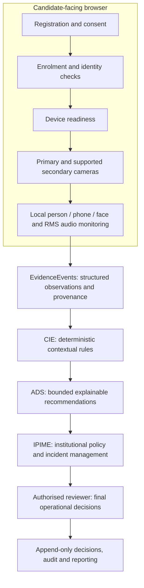
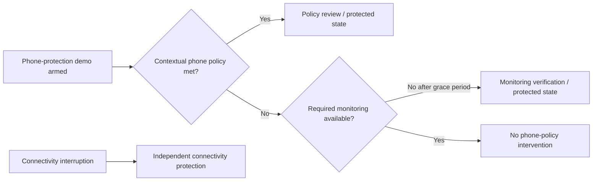

# SERPS architecture overview

> **Scope:** RC1 research-prototype architecture as documented in the published recovery branch. This page describes bounded capabilities, not production certification.

## Evidence-to-decision architecture

### Trust and governance boundaries

- **Browser:** Local camera, object and audio-activity analysis. Monitoring evidence is not equivalent to proof of misconduct.
- **API:** Server-side authentication, RBAC, candidate ownership, institution isolation, evidence ingestion, policy and audit enforcement.
- **Reviewer:** Interprets evidence and retains authority for consequential decisions. Administrator oversight is separate from reviewer decisions.
- **Data:** SQLite is used for the preserved native research runtime. PostgreSQL is the proposed staging target, not yet validated for all live concurrency paths.
- **Privacy:** The described local monitors do not store raw camera/microphone streams by default. Prototype facial descriptors and governance records still require access controls and responsible handling.

## Camera configuration boundaries

| Mode | Intended arrangement | Publication caveat |
| --- | --- | --- |
| A | Single candidate-facing camera | Documented project configuration; verify the specific workflow before describing as physically accepted |
| B | Primary candidate-facing plus distinct secondary environmental camera | RC1 candidate workspace implements and checks distinct cameras; physical hardware acceptance remains pending |
| C | Single camera with physical mirror for extended environmental visibility | Planned/design-level configuration; do not imply full RC1 physical implementation or validation |

## Exam Protect: independent protection causes

The current implementation contains separate protection reasons: `policy_review`, `monitoring_verification`, and `connectivity_interrupted`. The phone-protection demo control can also make monitoring loss trigger a five-second protective pause. This is being investigated for policy/UI clarity in [Issue #2](https://github.com/basil-emeokoro/SERPS/issues/2). **This diagram describes current observed code paths, not a confirmed final policy specification.**

## Acceptance boundaries

[Native runtime integration](native_runtime_integration.md) records the October 2026 synthetic validation. Real-camera acceptance, biometric field validation, sleep/resume, PostgreSQL concurrency and the completion-in-flight race remain outstanding. See [restricted deployment alternatives](runtime_deployment_alternatives.md) before proposing any external service.
